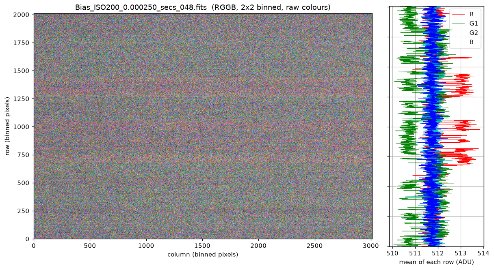
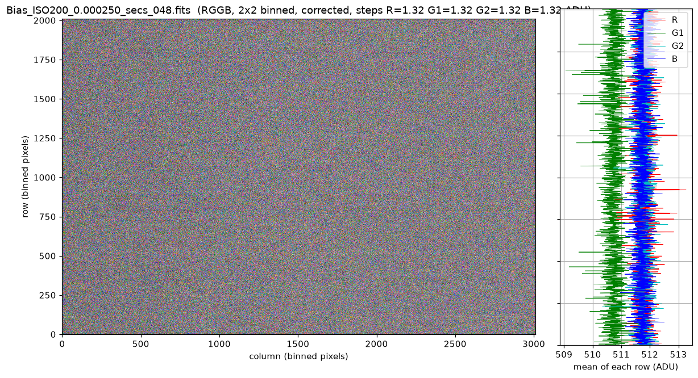
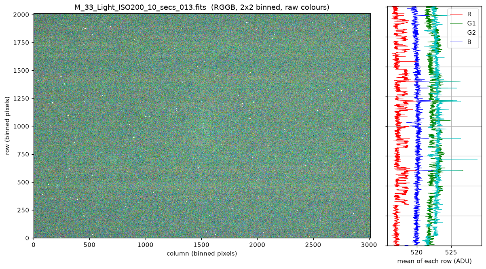
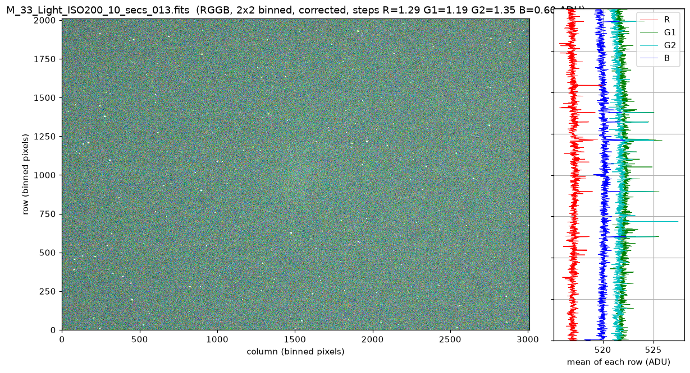

# banding-correction

Remove horizontal banding from raw CFA (Bayer) astronomical images (FITS).

The banding is a constant offset per row that changes in steps along the image,
independently for each Bayer channel (R, G1, G2, B). It is all the more visible
as the ISO value is low. The tool detects the steps on
the vertical profile of each channel (stars masked), estimates the step size per
channel, and subtracts the cumulative offset from every row.

## Installation

```bash
pip install -e .            # add [plot] for --plot, [test] for pytest
```

## Usage

```bash
banding-correction input.fits output.fits --overwrite --plot profiles.png
# or: python -m banding_correction input.fits output.fits
```

The Bayer layout is read from the `BAYERPAT` header keyword (default `RGGB`).
Run `banding-correction --help` for all options.

From Python:

```python
from banding_correction import correct_image
corrected, profiles, steps = correct_image(data, "RGGB")
```

## Examples

Here is an example of a bias image (ISO 200) showing banding in the R and G1 channels. The G2 and B channels are flat, as expected.



After applying the banding correction, the image looks like this. All channels are now flat.



Here is another example, a deep sky object with an exposure time of 10 seconds.





## License

Apache-2.0
